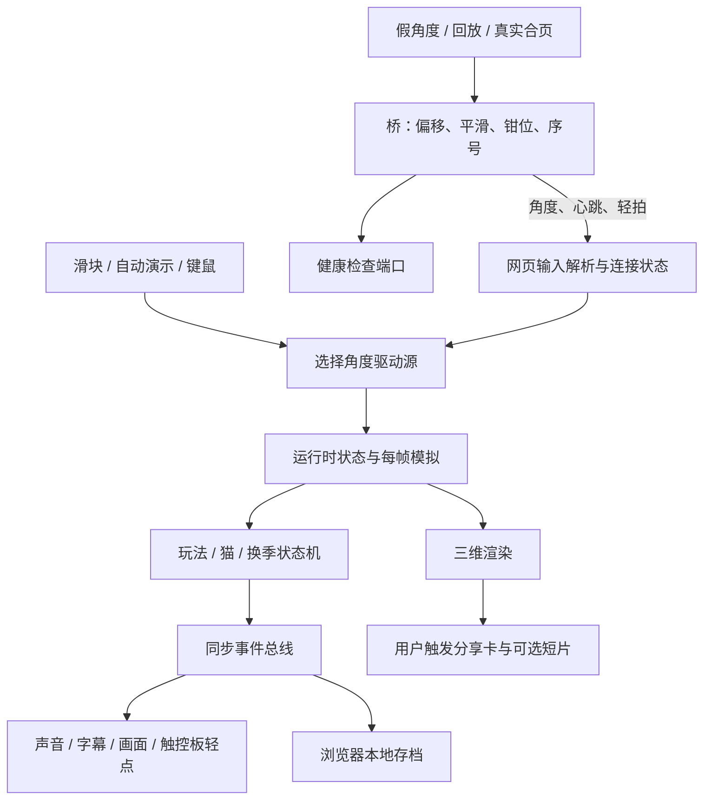

# 林间小屋接管报告

## 当前状态与最近更新

2026-11-05（Asia/Shanghai），按稳定性迭代结果进行知识更新。当前分支 `main`，提交 `bdf9b5cb36f6b19428f34139d44f043f815d3ca1`；稳定性改进提交 `a335640` 已合并并推送。更新前工作区干净，本次仅修改文档。

已核对合并提交与 `a335640` 的文件树完全一致，因此可沿用该代码内容的已有验证证据；本次没有重跑业务测试，也未查询远程持续集成结果。后续代码变化需要重新判断相关验证是否仍适用。

- 已完成：独立测试环境、不安装检查模式、可选硬件隔离；修复重连沿用旧角度时间和录制失败遗留视频轨道。
- 已有证据：规则与类型检查通过；前端 149 项通过；Python 38 项无失败、1 跳过；浏览器冒烟 28/28、分享 25/25、换季 10/10；本机合页两轮静置读取及关闭后重开通过。
- 仍未完成：连续真实开合、原生程序共读、锁屏/休眠恢复、触控板物理反馈、人耳听感、真实图形性能、打包安装验收。
- 当前复现入口：依赖准备后运行 `./start.sh test --no-install`，使用独立 `.venv-test`；测试桥禁用可选硬件。环境、命令、日志和验收细节见 [稳定性迭代与验收](stability.md)。

## 首次接管范围与历史基线

日期：2026-11-05，Asia/Shanghai。目标：`/Users/ssr/project/popup-book-web`，首次接管、标准深度。分支 `creative/v14`，提交 `e1ba300bf163190fd2efadf7000d5611ee1afabf`。

首次接管前已有两处未提交修改，当时已纳入阅读但保持原样（现均已纳入 `a335640`，合页实现另补诊断与测试）：

- `backend/sensors/lid.py`：通过 `ctypes`（调用本机动态库的接口）设置合页设备共享打开，缺少符号时抛出异常。
- `backend/static_server.py`：启用 HTTP/1.1（网页传输协议的长连接版本），等待连接队列改为 128。

所以首次接管的提交号不能完整代表当时的核验对象。首次接管阶段仅新增知识文档与 README 导航；后续稳定性开发、验证、提交与合并以本页开头的当前状态及专项验收记录为准。

覆盖前后端入口、主要模块、角度协议、存档、换季及隐藏恢复、分享和打包配置；重点追踪角度驱动与合盖换季，因为它们直接决定主要体验和持久状态。第三方 `frontend/vendor/three.module.js`、图片等资源未逐项审计；不穷举视觉效果、音色、各设备性能与全部异常分支。旧 README、REVIEW、PERFORMANCE 中的历史运行陈述不算首次接管实测。

## 项目是什么，当前做到哪里

已确认事实：这是本机为主的互动纸艺立体书。用户通过滑块、自动扫角或 MacBook 盖角展开森林、小屋和猫；开合速度、停留、摇晃触发反应及八个秘密；完整开合推进四季，进度存于浏览器。依据 `frontend/index.html`、`js/main.js`、`story.js`、`play-machine.js` 与 `store-core.js`。

前端是原生 JavaScript 模块，使用随仓库保存的 Three.js（三维场景绘制库），无需前端打包。Python 桥通过 WebSocket（网页与本机服务之间的持续消息连接）推送角度。没有看到账号、服务端业务数据库或云端存档链路；存档归属于当前浏览器站点，换主机名或端口可能进入另一份站点存储。

主体已超出页面骨架，输入、状态机、绘制、声音、字幕、存档及分享在源码中有装配。稳定性迭代已补齐本地自动检查及浏览器主要链路证据，并验证本机合页静置读取；真实开合、锁屏、物理反馈和真实图形性能仍未完整验收，不能据此写成产品验收完成。

## 仓库地图与运行入口

| 路径 | 职责与接续入口 |
|---|---|
| `frontend/index.html` → `js/main.js` | 单页入口，创建世界、界面、声音、输入、订阅与帧循环 |
| `js/world.js`、`gfx.js`、`build-*.js` | 世界对象、相机、网格、材质及场景 |
| `js/input.js`、`protocol.js`、`control.js` | 消息解析、连接状态、驱动源选择、键鼠和触控板输入 |
| `js/sim.js`、`sim-*.js` | 每帧推进运动、场景、猫、环境光与手感 |
| `js/*-machine.js`、`rules.js`、`tuning.js` | 判定、状态转换和手感阈值 |
| `js/bus.js`、`*-wire.js` | 将判定事件接到字幕、声音、绘制、存档及反馈 |
| `js/store.js`、`store-core.js`、`kitten-memory.js` | 浏览器存储适配、存档结构、猫的见面记录 |
| `js/share-*.js` | 分享排版、画布导出、剪贴板和可选短片 |
| `backend/bridge.py` → `broadcast.py` | 参数、选择角度源、广播、健康状态和可选旁路 |
| `backend/sensors/` | 假角度、轨迹回放、真实合页、可选触控板力度 |
| `start.sh` | 后台启动、依赖准备、模式、健康检查和停止 |
| `tests/unit/`、`tests/e2e/` | 纯逻辑测试、桥集成检查、浏览器冒烟和分享/换季测试 |
| `packaging/`、`docker/`、`.github/workflows/` | 命令封装、Mac 打包、容器、持续集成与发布配置 |

源码定位、尚未逐一完成启动器验收的方式：`./start.sh --slider --no-docker`、`./start.sh --fake --no-docker`、`./start.sh --sensor --no-docker`。`start.sh` 默认是假桥，`bridge.py` 单独运行默认是真实合页；两者不要混淆。静态端口默认 19081，桥 19876，健康检查 19877；启动器支持 `POPUP_PORT`、`POPUP_WS_PORT`、`POPUP_HTTP_PORT`。页面 `?ws=` 可改桥地址。

依赖：前端运行使用仓库内模块；开发检查依赖 package.json 中的 ESLint（代码规则检查器）与 TypeScript（此处检查 JavaScript 类型）。桥基础依赖 `websockets>=12`，真实合页另需 `requirements-sensor.txt` 及本机设备库；浏览器测试需要 Playwright（浏览器自动化工具）与 Pillow（图像处理库）。

检查环境已准备为 Node.js 22 与 Python 3.12 的独立 `.venv-test`，原传感器环境保留。`./start.sh test --yes` 可准备依赖并检查，`./start.sh test --no-install` 不自动安装；桥参数 `--no-optional-hardware` 禁止触控板采集和物理轻点，不禁用角度源及回放力度。

## 核心链路与状态归属

1. **角度到画面**：`bridge.build_source` 选择来源，`broadcast._loop` 读取并处理角度，发协议 v1（第一版消息契约）及心跳；`input.createInput` 缓冲、解析、过滤旧序号，`controlSource` 决定角度归属。目标角度写入 `S.target`，模拟再推进过滤值和场景。`main.js` 装配而不直接写玩法。
2. **断线和过期**：`protocol.linkState` 以 1500 毫秒为角度新鲜度阈值；心跳不刷新角度时间。连接异常走关闭再重连，握手有 1500 毫秒看门狗。手动自动演示优先；新鲜实机角度优先于滑块；关闭假桥演示可交还滑块。新连接打开时重置最后角度时间和消息序号，先等待首帧。浏览器模拟消息已覆盖仅有心跳时过期、断线重连及新序号恢复；不能代替真实传感器断连验收。
3. **合盖与换季**：`play-machine.js` 判定合盖并发 `close`，`play-wire.js` 增加存档 cycles、调用 `setSeason` 并显示晚安/重合盖反馈。`season-machine.js` 在再次打开时推进过渡；隐藏期间由 `input.js` 记住合盖，回到可见后在输入排空后调用 `noteSeasonReveal` 决定补播。补播中再次合盖有取消逻辑。这是后台恢复的重点回归链路。
4. **发现秘密与存档**：判定发事件，订阅端调用 `W.discover`；存档适配器用键 `popup-book.forest-cabin.v2` 写入 localStorage（浏览器站点本地存储）。`store-core` 包含 cycles、秘密及季节记录、静音、手感、环境光开关、贴纸本、猫记忆等。存储失败静默退为内存；`?nostore=1` 不读写持久存储，`?reset=1` 从空存档初始化并会保存，调试时要区分。
5. **可选旁路**：light 为照度、weight 为归一化力度，缺字段表示没有通道，不等同于零。`AmbientProbe.read` 仅调用 `pinned_lux`，真实合页当前并不读取物理环境光，固定照度来自 `POPUP_LUX`；假桥有演示照度，回放读文件。力度独立于角度；默认广播在无回放力度接口时尝试本机触控板子进程；硬件隔离参数关闭此旁路，自动检查统一启用隔离。轻拍是已分类事件，网页还能反向请求固定触控板轻点。
6. **分享**：`share-wire.attachShare` 接按钮和 C 键，显式捕获三维画面、合成卡片、生成图片、尝试剪贴板；短片按开关与浏览器能力决定。忙碌、防止重入、抓帧失败和录制失败均有分支。源码没有把分享接到社交平台上传；浏览器已实测图片下载、短片生成及剪贴板拒绝、录制失败和重复点击；录制构造/启动失败现会释放视频轨道。其他浏览器权限与格式兼容仍未全面覆盖。

## 功能矩阵

“完整”仅表示已识别场景的静态步骤衔接，不表示真机可用。

| 场景 | 实现程度 | 入口与实现证据 | 最近验证（2026-11-05） | 问题/未知 |
|---|---|---|---|---|
| 手动 / 假桥 / 回放角度 | 完整 | input、control、protocol；bridge、fake、replay | U1、U2、U3；假桥与模拟实机连接、切换、过期和重连通过，回放为单元覆盖 | 回放完整网页流程未单独验收 |
| 真实合页读取 | 完整（静态主链路） | lid.PyBookLidSource、configure_shared_hid | U5：两轮各 20 个有效样本，关闭后重开通过 | K2；原生共读、全角度和真实开合未知 |
| 展开、昼夜、猫与秘密 | 完整 | main、sim、play-machine、kitten-machine、play-wire | U1、U3；主要判定与浏览器冒烟通过 | 人耳、真实图形性能和全部秘密视觉未逐项验收 |
| 四季 / 后台恢复补播 | 完整 | season-machine、input、main、play-wire | U1、U3：可见性模拟补播、取消及单次计数通过 | K4；真实锁屏/休眠未测 |
| 存档、贴纸、猫记忆 | 完整 | store、store-core、journal-*、kitten-* | U1、U3：刷新保留、nostore 隔离、存储拒绝退内存通过 | 容量异常与所有贴纸/记忆界面分支未逐项覆盖 |
| 环境光映射 | 部分（物理采集缺失） | ambient-light；sensors/ambient.AmbientProbe | U1–U3：纯逻辑、假桥照度开关通过 | K3；物理采集不在本轮范围 |
| 轻拍、触控板逗猫和力度礼物 | 完整（静态链路） | tap-*、trackpad-*、track-weight-*、force、haptic | U1–U3：纯逻辑、模拟礼物和消息处理/硬件隔离通过 | 实机力度和物理反馈未验收 |
| 分享卡与短片 | 完整（静态链路） | share-wire、share-capture、share-layout | U1、U3：图片、短片、失败降级和忙碌拒绝通过 | 其他浏览器及系统权限组合未全面验证 |
| 打包与发布 | 完整（脚本链路） | packaging、release.yml、docker | 历史 V3 仅脚本语法；代码已推送 main | Git 推送不是产品发布；打包、部署、远程持续集成结果未知 |

## 最近验证摘要

以下结果来自稳定性迭代执行记录，已复读本地日志；本次文档更新没有重新执行这些业务检查。代码内容对应 `a335640`，当前合并提交 `bdf9b5c` 的文件树与其一致。环境、命令和完整边界见 [稳定性验收记录](stability.md)。

| 编号 | 检查与结果 | 证据与限制 |
|---|---|---|
| U1 | 规则与类型检查通过，前端 149 项通过 | `.run/test-suite.log`；Node.js 22.23.4；包含录制失败资源回收 |
| U2 | Python 38 项无失败、1 跳过 | 同上；Python 3.12.11；含桥集成与硬件隔离。部分平台专用分支未实际执行 |
| U3 | 浏览器冒烟 28/28、分享 25/25、换季 10/10 | `.run/test-smoke.log`、`test-share_card.log`、`test-season_catchup.log`；软件渲染，非真实锁屏 |
| U4 | 240 个并发模块加载请求及 5 次同连接请求通过 | `.run/test-suite.log`；支持原静态服务改动的当前本机场景，非长时压测 |
| U5 | 真实合页两轮各 20 个有效样本，103–104°，关闭后重开通过 | `.run/hardware-lid.log`；原传感器环境 pybooklid 1.0.0、hidapi 0.15.0；非连续开合及原生共读 |
| U6 | 固定窗口四场景帧调度间隔已记录，图片分享成功 | `.run/performance-default.json`；浏览器实际为软件渲染，不能推断真实图形性能 |

上述日志是本机忽略产物，可能被清理；已将关键结果和限制沉淀到版本控制内的专项验收文档。

## 首次接管检查记录（历史）

环境：本机 macOS，Node.js v25.2.1；系统 Python 与 backend/.venv 均为 3.9.6。虚拟环境具备 websockets，缺 Playwright、Pillow；项目无 node_modules。持续集成配置使用 Node.js 22、Python 3.12，与当前环境不同，当前结果不能代表该环境。

以下 V1–V6 仅代表首次接管当时的环境与脏工作区基线；依赖缺失和未执行状态不再代表稳定性迭代后的当前状态：

| 编号 | 方法与命令 | 结果 | 证据范围与限制 |
|---|---|---|---|
| V1 | `node --test tests/unit/*.test.js` | 147 项通过，0 失败，0 跳过 | 日志 `/tmp/popup-takeover-js-tests.log`；纯逻辑，不含真实网页与设备 |
| V2 | `PYTHONDONTWRITEBYTECODE=1 PYTHONPATH=backend:tests/unit backend/.venv/bin/python -m unittest test_protocol test_sensors test_force test_haptic.HapticMessageTest` | 28 项，0 失败，1 跳过 | 跳过非 macOS 的触控板断言；若干非 Darwin 专用分支在 Mac 直接返回，不代表被实测。覆盖协议、假源、回放、照度、力度门和轻点消息解析，未运行桥集成类 |
| V3 | `bash -n start.sh packaging/popup-book packaging/check.sh packaging/assemble-release.sh packaging/mac/*.sh` | 通过 | 仅 shell 脚本语法；不执行打包产物创建 |
| V4 | ESLint / TypeScript 检查 | 受阻，未执行 | 本项目没有 node_modules，未安装依赖 |
| V5 | 浏览器冒烟、分享、换季集成 | 受阻，未执行 | 虚拟环境没有 Playwright、Pillow；未安装浏览器 |
| V6 | 真实合页 / 力度 / 声音 / 打包 / 外部发布 | 未执行 | 本轮未启设备及服务，没有相应运行证据 |

首次接管时没有运行 `./start.sh test --yes`：脚本可能安装 npm/Python 依赖和浏览器，还会启动服务。没有运行完整 Python 发现命令：其中桥集成测试启动假桥，但在 macOS 下仍会尝试触控板力度通道，轻点集成还会发送物理反馈请求。没有运行 `packaging/check.sh`：其会执行本机 app/dmg 构建脚本，不能当成纯语法检查。

## 问题、未知与优先后续

沿用首次接管的 K1–K4 编号，更新处理状态，不将已完成的环境准备继续列为待办。

| 编号 / 级别 | 当前状态 | 证据与剩余边界 | 下一步 |
|---|---|---|---|
| K1 / 原 P2（中） | 版本与能力表述已修订 | README 失效的 v9 当前版本表述已移除；v14 已并入 main。分支合并不代表产品发布 | 后续发布时再单独登记标签、打包与安装结果 |
| K2 / P2（中） | 当前环境读取与重开通过，兼容性风险仍有边界 | configure_shared_hid 补诊断和模拟测试；U5 支持当前依赖，不证明其他 hid 扩展版本或原生程序共读 | 优先验收连续开合、与原生程序共读及锁屏后读取恢复；不默认升级设备依赖 |
| K3 / 原 P2（中） | 能力说明已澄清；物理采集仍未实现 | README、ADAPTERS 和 AmbientProbe 明确演示/回放/固定值来源 | 只有确有自动感知房间亮度需求时，再单独规划物理采集 |
| K4 / P2（中） | 环境、静态服务及浏览器覆盖缺口已补齐；真机验收未完成 | U1–U4 已通过；U6 只有软件渲染证据 | 优先验收真实锁屏/休眠、物理反馈与人耳听感，再取得真实图形性能基线 |

建议接续顺序：真实连续开合与锁屏恢复 → 原生程序共读及可选物理通道 → 真实图形性能；有分发需求时再验收打包安装。具体操作和结果登记在 [真机人工验收清单](stability.md#真机人工验收清单)。这是后续建议，不是既有强制规则。

当前已完成源码提交和 main 推送；尚未验证远程持续集成、产品发布、线上服务、依赖漏洞或支持周期。不得把已推送代码写成产品已发布或线上正常。

## 更新记录

- 2026-11-05 首次接管：建立项目地图、首次检查记录和 K1–K4。
- 2026-11-05 稳定性迭代：实现与检查详见 [稳定性迭代与验收](stability.md)，代码收敛为 `a335640`。
- 2026-11-05 合并后知识更新：基于 `main` 的 `bdf9b5c` 核对源码、合并关系与已有日志，更新当前基线、功能矩阵、验证摘要及问题状态；保留 V1–V6 历史记录。此次只更新文档，未重新运行业务测试。
