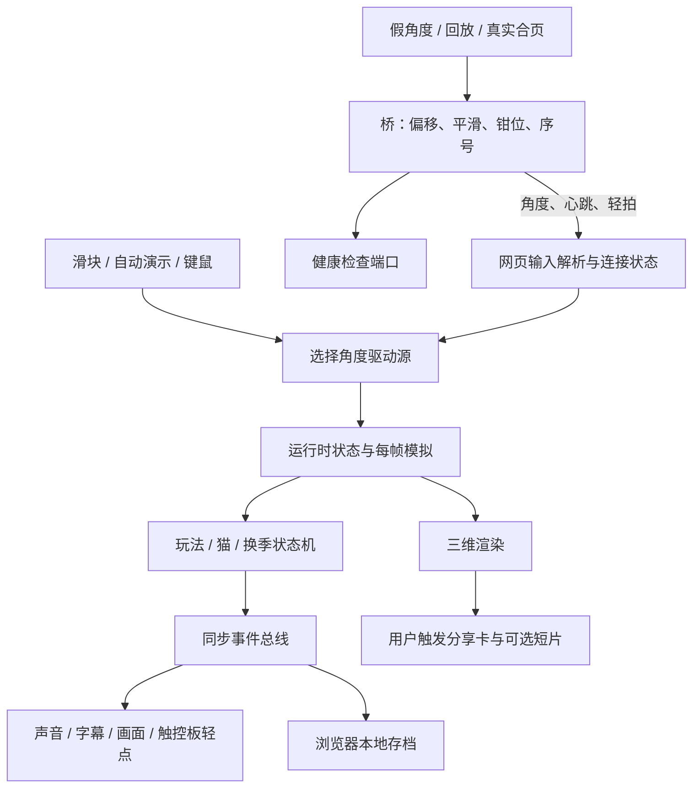

# 林间小屋接管报告

## 核验范围与基线

日期：2026-11-05，Asia/Shanghai。目标：`/Users/ssr/project/popup-book-web`，首次接管、标准深度。分支 `creative/v14`，提交 `e1ba300bf163190fd2efadf7000d5611ee1afabf`。

接管前已有两处未提交修改，已纳入阅读但保持原样：

- `backend/sensors/lid.py`：通过 `ctypes`（调用本机动态库的接口）设置合页设备共享打开，缺少符号时抛出异常。
- `backend/static_server.py`：启用 HTTP/1.1（网页传输协议的长连接版本），等待连接队列改为 128。

所以提交号不能完整代表本轮核验对象。新增内容仅为知识文档与 README 导航；没有修复业务代码、安装依赖、启动硬件、发布或提交推送。

覆盖前后端入口、主要模块、角度协议、存档、换季及隐藏恢复、分享和打包配置；重点追踪角度驱动与合盖换季，因为它们直接决定主要体验和持久状态。第三方 `frontend/vendor/three.module.js`、图片等资源未逐项审计；不穷举视觉效果、音色、各设备性能与全部异常分支。旧 README、REVIEW、PERFORMANCE 中的历史运行陈述不算本轮实测。

## 项目是什么，当前做到哪里

已确认事实：这是本机为主的互动纸艺立体书。用户通过滑块、自动扫角或 MacBook 盖角展开森林、小屋和猫；开合速度、停留、摇晃触发反应及八个秘密；完整开合推进四季，进度存于浏览器。依据 `frontend/index.html`、`js/main.js`、`story.js`、`play-machine.js` 与 `store-core.js`。

前端是原生 JavaScript 模块，使用随仓库保存的 Three.js（三维场景绘制库），无需前端打包。Python 桥通过 WebSocket（网页与本机服务之间的持续消息连接）推送角度。没有看到账号、服务端业务数据库或云端存档链路；存档归属于当前浏览器站点，换主机名或端口可能进入另一份站点存储。

主体已超出页面骨架，输入、状态机、绘制、声音、字幕、存档及分享在源码中有装配。单元检查支持纯逻辑工作正常；本轮没有浏览器和真机完整流程证据，不能据此写成产品验收完成。

## 仓库地图与运行入口

| 路径 | 职责与接续入口 |
|---|---|
| `frontend/index.html` → `js/main.js` | 单页入口，创建世界、界面、声音、输入、订阅与帧循环 |
| `js/world.js`、`gfx.js`、`build-*.js` | 世界对象、相机、网格、材质及场景 |
| `js/input.js`、`protocol.js`、`control.js` | 消息解析、连接状态、驱动源选择、键鼠和触控板输入 |
| `js/sim.js`、`sim-*.js` | 每帧推进运动、场景、猫、环境光与手感 |
| `js/*-machine.js`、`rules.js`、`tuning.js` | 判定、状态转换和手感阈值 |
| `js/bus.js`、`*-wire.js` | 将判定事件接到字幕、声音、绘制、存档及反馈 |
| `js/store.js`、`store-core.js`、`kitten-memory.js` | 浏览器存储适配、存档结构、猫的见面记录 |
| `js/share-*.js` | 分享排版、画布导出、剪贴板和可选短片 |
| `backend/bridge.py` → `broadcast.py` | 参数、选择角度源、广播、健康状态和可选旁路 |
| `backend/sensors/` | 假角度、轨迹回放、真实合页、可选触控板力度 |
| `start.sh` | 后台启动、依赖准备、模式、健康检查和停止 |
| `tests/unit/`、`tests/e2e/` | 纯逻辑测试、桥集成检查、浏览器冒烟和分享/换季测试 |
| `packaging/`、`docker/`、`.github/workflows/` | 命令封装、Mac 打包、容器、持续集成与发布配置 |

源码定位但本轮未运行的启动方式：`./start.sh --slider --no-docker`、`./start.sh --fake --no-docker`、`./start.sh --sensor --no-docker`。`start.sh` 默认是假桥，`bridge.py` 单独运行默认是真实合页；两者不要混淆。静态端口默认 19081，桥 19876，健康检查 19877；启动器支持 `POPUP_PORT`、`POPUP_WS_PORT`、`POPUP_HTTP_PORT`。页面 `?ws=` 可改桥地址。

依赖：前端运行使用仓库内模块；开发检查依赖 package.json 中的 ESLint（代码规则检查器）与 TypeScript（此处检查 JavaScript 类型）。桥基础依赖 `websockets>=12`，真实合页另需 `requirements-sensor.txt` 及本机设备库；浏览器测试需要 Playwright（浏览器自动化工具）与 Pillow（图像处理库）。

## 核心链路与状态归属

1. **角度到画面**：`bridge.build_source` 选择来源，`broadcast._loop` 读取并处理角度，发协议 v1（第一版消息契约）及心跳；`input.createInput` 缓冲、解析、过滤旧序号，`controlSource` 决定角度归属。目标角度写入 `S.target`，模拟再推进过滤值和场景。`main.js` 装配而不直接写玩法。
2. **断线和过期**：`protocol.linkState` 以 1500 毫秒为角度新鲜度阈值；心跳不刷新角度时间。连接异常走关闭再重连，握手有 1500 毫秒看门狗。手动自动演示优先；新鲜实机角度优先于滑块；关闭假桥演示可交还滑块。当前本轮只对相关纯函数做了测试，没有实际断线实测。
3. **合盖与换季**：`play-machine.js` 判定合盖并发 `close`，`play-wire.js` 增加存档 cycles、调用 `setSeason` 并显示晚安/重合盖反馈。`season-machine.js` 在再次打开时推进过渡；隐藏期间由 `input.js` 记住合盖，回到可见后在输入排空后调用 `noteSeasonReveal` 决定补播。补播中再次合盖有取消逻辑。这是后台恢复的重点回归链路。
4. **发现秘密与存档**：判定发事件，订阅端调用 `W.discover`；存档适配器用键 `popup-book.forest-cabin.v2` 写入 localStorage（浏览器站点本地存储）。`store-core` 包含 cycles、秘密及季节记录、静音、手感、环境光开关、贴纸本、猫记忆等。存储失败静默退为内存；`?nostore=1` 不读写持久存储，`?reset=1` 从空存档初始化并会保存，调试时要区分。
5. **可选旁路**：light 为照度、weight 为归一化力度，缺字段表示没有通道，不等同于零。`AmbientProbe.read` 仅调用 `pinned_lux`，真实合页当前并不读取物理环境光，固定照度来自 `POPUP_LUX`；假桥有演示照度，回放读文件。力度独立于角度；广播在无回放力度接口时尝试本机触控板子进程。轻拍是已分类事件，网页还能反向请求固定触控板轻点。
6. **分享**：`share-wire.attachShare` 接按钮和 C 键，显式捕获三维画面、合成卡片、生成图片、尝试剪贴板；短片按开关与浏览器能力决定。忙碌、防止重入、抓帧失败和录制失败均有分支。源码没有把分享接到社交平台上传；真实下载、权限与录屏格式兼容未实测。

## 功能矩阵

“完整”仅表示已识别场景的静态步骤衔接，不表示真机可用。

| 场景 | 实现程度 | 入口与实现证据 | 本轮验证 | 问题/未知 |
|---|---|---|---|---|
| 手动 / 假桥 / 回放角度 | 完整 | input、control、protocol；bridge、fake、replay | V1、V2；消息和来源纯逻辑 | 浏览器连接未测 |
| 真实合页读取 | 完整（静态主链路） | lid.PyBookLidSource、broadcast | V3 只做语法检查 | K2，共享打开与设备实测未知 |
| 展开、昼夜、猫与秘密 | 完整 | main、sim、play-machine、kitten-machine、play-wire | V1 判定逻辑 | 真实画面、音色与性能未知 |
| 四季 / 后台恢复补播 | 完整 | season-machine、input、main、play-wire | V1 对应状态机测试 | 实际锁屏恢复未测 |
| 存档、贴纸、猫记忆 | 完整 | store、store-core、journal-*、kitten-* | V1 内存适配逻辑 | 浏览器持久性、清理及容量异常未测 |
| 环境光映射 | 部分（物理采集缺失） | ambient-light；sensors/ambient.AmbientProbe | V1、V2 | K3 |
| 轻拍、触控板逗猫和力度礼物 | 完整（静态链路） | tap-*、trackpad-*、track-weight-*、force、haptic | V1、V2 的纯逻辑 | 实机压力与物理反馈未测 |
| 分享卡与短片 | 完整（静态链路） | share-wire、share-capture、share-layout | V1 排版与计划逻辑 | 实际图片/剪贴板/短片未测 |
| 打包与发布 | 完整（脚本链路） | packaging、release.yml、docker | V3 仅 shell 语法 | 未打包、未部署、未查询远程状态 |

## 本轮检查记录

环境：本机 macOS，Node.js v25.2.1；系统 Python 与 backend/.venv 均为 3.9.6。虚拟环境具备 websockets，缺 Playwright、Pillow；项目无 node_modules。持续集成配置使用 Node.js 22、Python 3.12，与当前环境不同，当前结果不能代表该环境。

以下均为上述日期及脏工作区基线：

| 编号 | 方法与命令 | 结果 | 证据范围与限制 |
|---|---|---|---|
| V1 | `node --test tests/unit/*.test.js` | 147 项通过，0 失败，0 跳过 | 日志 `/tmp/popup-takeover-js-tests.log`；纯逻辑，不含真实网页与设备 |
| V2 | `PYTHONDONTWRITEBYTECODE=1 PYTHONPATH=backend:tests/unit backend/.venv/bin/python -m unittest test_protocol test_sensors test_force test_haptic.HapticMessageTest` | 28 项，0 失败，1 跳过 | 跳过非 macOS 的触控板断言；若干非 Darwin 专用分支在 Mac 直接返回，不代表被实测。覆盖协议、假源、回放、照度、力度门和轻点消息解析，未运行桥集成类 |
| V3 | `bash -n start.sh packaging/popup-book packaging/check.sh packaging/assemble-release.sh packaging/mac/*.sh` | 通过 | 仅 shell 脚本语法；不执行打包产物创建 |
| V4 | ESLint / TypeScript 检查 | 受阻，未执行 | 本项目没有 node_modules，未安装依赖 |
| V5 | 浏览器冒烟、分享、换季集成 | 受阻，未执行 | 虚拟环境没有 Playwright、Pillow；未安装浏览器 |
| V6 | 真实合页 / 力度 / 声音 / 打包 / 外部发布 | 未执行 | 本轮未启设备及服务，没有相应运行证据 |

没有运行 `./start.sh test --yes`：脚本可能安装 npm/Python 依赖和浏览器，还会启动服务。没有运行完整 Python 发现命令：其中桥集成测试启动假桥，但在 macOS 下仍会尝试触控板力度通道，轻点集成还会发送物理反馈请求。没有运行 `packaging/check.sh`：其会执行本机 app/dmg 构建脚本，不能当成纯语法检查。

## 问题、未知与优先后续

| 编号 / 优先级 | 问题、触发条件与影响 | 证据与可信度 | 建议与验证办法 |
|---|---|---|---|
| K1 / P2（中） | README 自述 v9，但当前分支 creative/v14，已有后续互动模块。沿旧版本说明接手会误判范围 | README、当前分支和 main 装配；已确认文档版本表述滞后 | 先以本报告和源码定位范围，下一轮集中核对版本、发布及历史验证措辞；不要直接把分支名当已发布版本 |
| K2 / P2（中） | 未提交的共享设备打开依赖 hid 扩展导出符号，跨依赖版本可能不能初始化。影响真实合页模式 | lid.__init__，静态兼容性风险，未复现故障 | 在保留这两处修改的前提下验证导入、符号、共享读取、断开重连及与原生程序共存；先确认运行依赖，别默认升级 |
| K3 / P2（中） | 若把“环境光”理解为自动读房间亮度，当前真实模式达不到这一预期 | AmbientProbe.read → pinned_lux；已确认实现边界，非传感器实测失败 | 产品上明确固定值/演示/回放来源；确有物理采集需求后再规划适配器 |
| K4 / P2（中） | 本轮只有逻辑测试和脚本语法，不能确认静态服务并发修改、浏览器画面及后台恢复 | V1–V6，已确认覆盖缺口 | 经依赖准备后先跑无硬件副作用的浏览器流程，再做实机体验验收；固定端口并检查占用，避免影响正在运行的实例 |

建议接续顺序：先准备缺失开发检查环境并执行静态检查；再隔离可选硬件旁路做浏览器联调；随后验证两处未提交修改和真实锁屏/合盖恢复；最后按发布目标核对打包路径。此顺序是本轮建议，不是既有强制规则。

本轮没有查询远程发布、线上服务、依赖漏洞或支持周期；不据版本号推断这些状态。现有发布配置能证明“如何发布”，不能证明已经发布成功。

## 后续迭代记录

2026-11-05：稳定性迭代已增加独立测试环境、不安装检查模式、可选硬件隔离与浏览器回归，并核验本机合页静置读取及重开。首次接管的 V1–V6 表保留为历史快照；当前结果及新增代码基线见 [稳定性迭代与验收](stability.md)，不再以首次接管时的“依赖缺失”描述当前环境。
